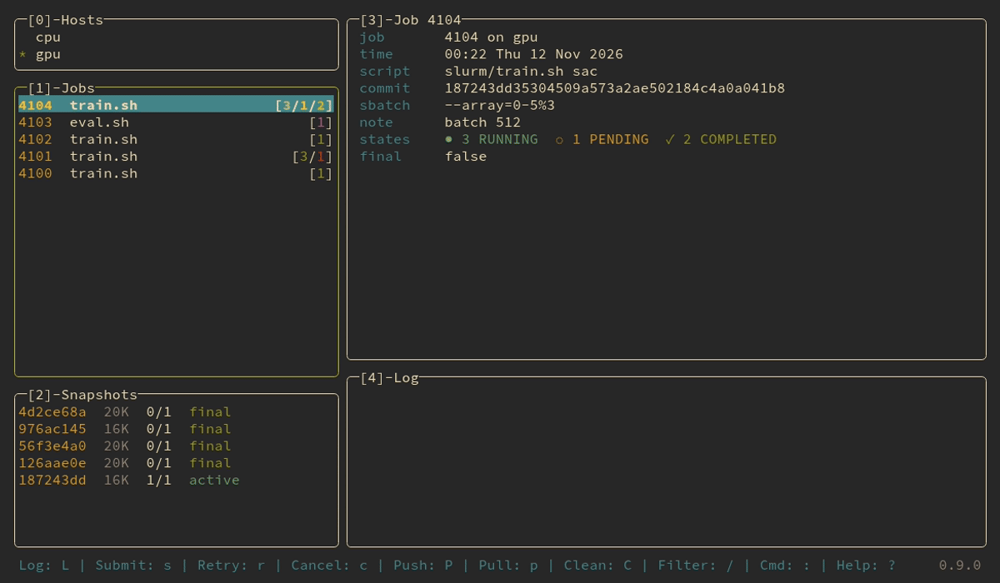

# lazyslurm

lazyslurm is a terminal UI and a command line for Slurm clusters, in the spirit of lazygit. Opened from a git repository, it pushes the code, submits jobs, follows them, pulls the results, retries and cancels. Nothing is installed on the cluster: everything goes through `ssh` and `rsync`.

A job runs in an immutable snapshot of the commit you submitted, so a push or another submission never changes a job that is queued or running. Snapshots are hardlinks, so they cost almost nothing, and they disappear once their jobs are over and their results are back.



## Installation

```sh
nix profile install github:paulchambaz/lazyslurm
```

Or see [**Building**](#building) for a manual install.

## Usage

Write `.slurm/config` at the root of your repository:

```toml
[default]
host    = "mycluster"
push    = ["src", "slurm", "pyproject.toml"]
keep    = [".venv", "outputs"]
pull    = ["outputs/results"]
scripts = ["slurm/*.sh"]

[hosts.mycluster]
target = "mycluster:myproject"
```

`mycluster` is a host of your `~/.ssh/config` and `myproject` is the folder lazyslurm owns there. Add `.slurm/state/` to your `.gitignore`, commit, and run `lazyslurm`. `?` lists every key.

The same things from the command line:

```sh
lazyslurm push
lazyslurm submit --yes slurm/train.sh --lr 3e-4
lazyslurm status
lazyslurm logs -f 24173638_0
lazyslurm pull
```

The commands that change the cluster ask `[y/N]` on a terminal, and do nothing without one unless `--yes` is given. Every option, the other configuration keys, the hooks and the rules for deleting are in the [man page](./lazyslurm.1.scd).

## Requirements

Here: `git`, `rsync`, `tar` and `ssh`. On the cluster: `bash`, `rsync`, `flock`, the Slurm clients, accounting enabled for `sacct`, and a filesystem with hardlinks.

## Building

```sh
nix develop # a shell with every dev tool
just build
just test
just install # binary and man page in ~/.local
just demo # try it on a made-up project, no cluster needed
```

Without Nix you need `go`, `scdoc` and `just`.

## Contribution

Contributions are welcome: feature suggestions, bug reports or code, through issues and pull requests on GitHub.

## License

<a href="https://www.gnu.org/licenses/gpl-3.0.en.html">
  
</a>

lazyslurm is free software. You can use, study, modify and distribute it under the
terms of the [GNU General Public License](https://www.gnu.org/licenses/gpl-3.0.en.html),
version 3.
